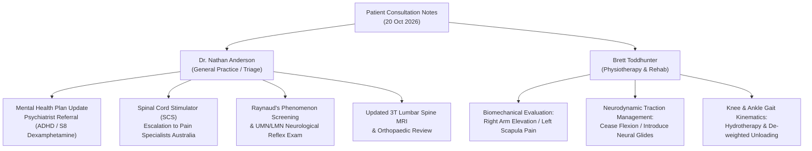

# Clinical Consultation & Specialist Review Notes: Dr. Nathan Anderson & Brett Toddhunter

**Patient:** James Jones  
**Date of Entry:** 20 October 2026 (13:47 AEDT)  
**Document Version:** 1.0.0  
**Status:** Active Clinical Preparation & Specialist Consultation Agenda  
**Source Email Subject:** `Notes for Dr. Nathan Anderson/Brett Toddhunter`  
**Distribution / Recipients:**  
- Dr. Nathan Anderson (General Practitioner / Primary Care Physician)  
- Brett Toddhunter (Pain Specialist / Interventional Pain & Neuromodulation Lead)  
- Multidisciplinary Medical Team (MDT) Records  

---

> [!IMPORTANT]
> **Medical Decision Support Disclaimer:** This synthesis document is structured clinical decision support compiled from patient-logged symptomatology and historical clinical data. It is intended to assist treating clinicians during clinical consults and does not constitute an independent medical diagnosis. Clinical evaluation, physical examination, and diagnostic imaging correlation remain the sole responsibility of the registered treating healthcare practitioners.

---

## 1. Executive Consultation Agenda & Checklist

Below is the structured agenda derived directly from the patient consultation notes, organized for bedside review with Dr. Nathan Anderson and Physiotherapist Brett Toddhunter:

| Status | Item # | Clinical Focus Area | Primary Provider | Action Required |
| :---: | :---: | :--- | :--- | :--- |
| **[X]** | **Item 1** | **Mental Health Care Plan Update & ADHD Pharmacotherapy** | Dr. Nathan Anderson (GP) | Formal referral to a Consultant Psychiatrist for diagnostic ADHD review and 2791/dexamphetamine authorization under Victorian Schedule 8 regulations. |
| **[ ]** | **Item 2** | **Left Scapular Pain on Right Overhead Elevation** | Brett Toddhunter (Physio) / Dr. Anderson | Biomechanical and kinetic chain evaluation of thoracic spine, cervicothoracic junction (C7-T1), and contralateral scapulothoracic kinematics. |
| **[ ]** | **Item 3** | **Lower Extremity Surgical Prioritization (Knee & Ankle)** | Dr. Anderson / Orthopaedic Team | Cost-benefit, surgical timing, and rehabilitation interference analysis regarding knee and ankle interventions vs. axial spinal stability. |
| **[ ]** | **Item 4** | **Intractable Lumbar Neuropathy & Spinal Cord Stimulator (SCS)** | Dr. Anderson / Pain Specialist | Pain Specialists Australia / tertiary pain clinic escalation for Spinal Cord Stimulation (SCS) candidate assessment. |
| **[ ]** | **Item 5** | **Cold-Induced Acral Vasospasm / Raynaud's Phenomenon (Index Fingers)** | Dr. Nathan Anderson (GP) | Clinical evaluation of peripheral microvascular vasospasm, cervical sympathetic chain irritation vs. primary/secondary Raynaud's phenomenon. |
| **[ ]** | **Item 6** | **Hyperreflexia Flaring with Sciatica** | Dr. Anderson / Neurosurgical MDT | Bedside neurological examination of Upper Motor Neuron (UMN) vs. Lower Motor Neuron (LMN) overlap (cervical myelomalacia vs. lumbar radiculopathy). |
| **[ ]** | **Item 7** | **Provocative Sciatic Neural Tension (Straight/Bent Leg Shockwaves to Lumbar Bulge)** | Brett Toddhunter / Dr. Anderson | Dynamic neurodynamic tension testing (Lasègue / Slump / modified neural glide), lumbar disc re-imaging, and acute radicular decompression protocols. |

---

## 2. Detailed Clinical Synthesis & Specialist Analysis

### Item 1: Mental Health Care Plan Update & Psychiatrist Referral (Dexamphetamine)
- **Patient Note:** `[X] 4) Mental health plan update - i need to see a psychiatrist so i can get on dexamphetamine`
- **Clinical Review (General Practice & Psychiatry):**
  - **Objective:** Update the existing GP Mental Health Treatment Plan (GPMHTP / MBS Item 2712 or 2715/2717) and issue a targeted referral to an adult ADHD psychiatrist.
  - **Regulatory Requirements (Victoria / SafeScript):** In Victoria, prescribing dexamphetamine (Schedule 8 psychostimulant) for adult ADHD mandates an initial comprehensive psychiatric diagnosis, assessment of comorbidities, and issuance of a Department of Health Schedule 8 permit / endorsement.
  - **Chronic Pain Interplay:** Chronic, severe neurogenic pain significantly degrades executive functioning, dopamine transmission, and attentional bandwidth. Effective management of neurocognitive symptoms is critical for rehabilitation compliance and cognitive endurance.
  - **Consult Action for Dr. Anderson:**
    1. Complete formal GPMHTP review and update documentation.
    2. Draft an urgent psychiatric referral letter detailing patient medical history, spinal trauma/surgical background, and indications for psychostimulant evaluation.

---

### Item 2: Left Scapular Pain Evoked by Contralateral (Right) Arm Overhead Elevation
- **Patient Note:** `[ ] 1) left scapula hurts when i raise my right arm above head`
- **Clinical Review (Physiotherapy & Biomechanics — Brett Toddhunter):**
  - **Kinetic Chain Mechanics:** Overhead elevation of the right shoulder induces right thoracic lateral flexion, right scapular upward rotation, and relative rotation of the mid-to-upper thoracic vertebrae (T1–T6). 
  - **Pathology & Differential:**
    1. *Contralateral Rhomboid/Levator Scapulae Eccentric Strain:* The left scapular retractors and stabilizers are forced into eccentric tension when the right shoulder reaches full overhead elevation.
    2. *Cervicothoracic Radicular Irritation (C7-T1 Junction):* Historical data indicates a significant baseline pain generator at the C7-T1 junction. Thoracic torsion during unilateral overhead movement can torque the posterior rib heads (costovertebral joints) or irritate the contralateral dorsal scapular nerve / upper thoracic facet capsules.
  - **Consult Action for Brett Toddhunter:**
    1. Assess active and passive scapulothoracic kinematics and rib cage expansion during bilateral and unilateral overhead reaching.
    2. Palpate left medial scapular border, rhomboids, levator scapulae, and left T1-T4 costovertebral articulations.
    3. Prescribe unilateral thoracic rotation and gentle latissimus/scapular decruitment stretches rather than bilateral overhead loading.

---

### Item 3: Lower Extremity Surgical Review & Prioritization (Knee & Ankle)
- **Patient Note:** `[ ] 2) i want to get everything fixed. Is it worth doibg my knee and ankle pr not?`
- **Clinical Review (Multidisciplinary Team / Orthopaedics & GP):**
  - **Surgical Burden & Strategic Timing:** Undergoing multiple simultaneous or closely staged orthopedic procedures (knee arthroscopy/reconstruction, ankle stabilization) during active spine rehabilitation presents substantial systemic stress.
  - **Gait Kinematics vs. Spine Vulnerability:** 
    - Unstable or painful peripheral joints (knee/ankle) disrupt the gait cycle, leading to antalgic limping, abnormal pelvic obliquity, and compensatory ground reaction forces transmitted directly upward into the sensitized lumbar and cervical spine.
    - Conversely, attempting peripheral lower-limb rehabilitation while acute lumbar radiculopathy and patellar hyperreflexia are active can compromise postoperative recovery.
  - **Specialist Recommendation for Dr. Anderson:**
    1. Obtain updated diagnostic imaging (weight-bearing bilateral knee and ankle series / MRI where indicated).
    2. Assess whether peripheral pathology is mechanical (ligamentous tear, chondral defect, meniscal tear) vs. referred radicular weakness from L4/L5/S1 nerve root irritation.
    3. Prioritize conservative structural preservation (targeted hydrotherapy, unweighted bracing, localized injections) until central neuro-axial symptoms stabilize.

---

### Item 4: Intractable Lumbar Spine Pain & Spinal Cord Stimulator (SCS) Evaluation
- **Patient Note:** `[ ] 3) My lumbar os agony ALWAYS, i NEED the spinal cord stimulator`
- **Clinical Review (Pain Medicine — Pain Specialists Australia / Dr. Anderson):**
  - **Clinical Picture:** Persistent, debilitating lumbar spine pain refractory to conservative multi-modal analgesia, producing continuous functional impairment.
  - **Spinal Cord Stimulation (SCS) Indications:**
    - Indicated for Failed Back Surgery Syndrome (FBSS), persistent lumbar radiculopathy, or intractable chronic neuropathic lower back and leg pain.
    - SCS works by delivering electrical impulses to the dorsal columns of the spinal cord, modulating nociceptive input before transmission to the brain cortex.
  - **Pre-Implantation Criteria & Escalation Pathway:**
    1. *Diagnostic Imaging Review:* Confirm current lumbar MRI scans document the precise anatomical level of thecal sac / nerve root compromise (e.g. L4-L5, L5-S1) and exclude progressive mechanical instability or spinal cord/cauda equina stenosis requiring open surgical decompression.
    2. *Formal Referral:* Expedite direct referral to Pain Specialists Australia / Dr. Nick Christelis or regional pain neuromodulation specialists for trial assessment.
    3. *Trial Phase:* Standard protocol mandates a temporary externalized percutaneous lead trial (3–7 days) to demonstrate $\ge 50\%$ pain relief and functional improvement before permanent battery implantation.

---

### Item 5: Cold-Induced Digital Acral Pallor & Numbness (Index Fingers)
- **Patient Note:** `[ ] 4) index fingers go white and numb when cold`
- **Clinical Review (Vascular & Neurological — Dr. Anderson):**
  - **Clinical Manifestation:** Classic triphasic or biphasic vasospastic response consistent with **Raynaud's Phenomenon** (cold-triggered digital pallor, numbness/paresthesia, followed by reactive hyperemia).
  - **Etiological Differential:**
    1. *Secondary Raynaud's due to Cervicothoracic Sympathetic Irritation:* The sympathetic outflow to the upper extremities originates in the upper thoracic cord (T1-T4) and courses through the stellate ganglion near the C7-T1 junction. The patient's verified C7-T1 spine history and surgical fusion may irritate postganglionic sympathetic fibers, predisposing the digital arterioles to exaggerated vasospastic responses.
    2. *Carpal Tunnel / Digital Neuropathy:* Median nerve sensory distribution selectively covers the palmar aspect and tip of the index finger.
    3. *Primary Raynaud's Disease / Autoimmune Vasculopathy:* Connective tissue screening.
  - **Consult Action for Dr. Anderson:**
    1. Bedside Allen's test and digital capillary refill inspection.
    2. Order basic autoimmune/connective tissue panel (ANA, ENA, rheumatoid factor, ESR, CRP) if not recently evaluated.
    3. Review warming protocols and conservative vasodilation measures (avoiding vasoconstrictive agents, ergonomic thermal gloves).

---

### Item 6: Lower Limb Hyperreflexia Exacerbation Correlating with Sciatica Flare
- **Patient Note:** `[ ] 5) hyperflexia is really bad, it gets worse when my sciatica does`
- **Clinical Review (Neurosurgery & Neurology):**
  - **Pathophysiological Paradox (UMN vs. LMN Co-existence):**
    - Sciatica is typically a **Lower Motor Neuron (LMN)** syndrome caused by compression of lumbosacral nerve roots (L4, L5, S1), which classically diminishes or abolishes peripheral reflexes.
    - However, the patient has an established history of severe cervical spinal cord myelopathy (decompressed/fused June 2026) causing baseline central disinhibition (**Upper Motor Neuron / UMN hyperreflexia**).
  - **Mechanism of Co-Exacerbation:**
    - *Spinal Cord Reflex Hyperexcitability (Central Sensitization):* Acute nociceptive afferent barrage from an inflamed lumbar nerve root floods the dorsal horn and ascends the spinal cord. In a cord with prior cervical myelomalacia, this high-intensity peripheral afferent input can heighten central motor neuronal excitability, amplifying the disinhibited patellar kick.
    - *Tandem Spinal Stenosis:* The presence of concurrent cervical and lumbar spinal canal stenosis can produce simultaneous UMN signs in the lower limbs alongside acute radicular sciatica.
  - **Consult Action for Dr. Anderson & Brett Toddhunter:**
    1. Test bilateral deep tendon reflexes (patellar L3/L4, Achilles S1) and evaluate for patellar or ankle clonus ($>3$ beats).
    2. Check bilateral Babinski response and Hoffmann's sign.
    3. Correlate with historical neurosurgical follow-up (Prof. Greg Cunningham) to ensure cervical spinal canal clearance.

---

### Item 7: Provocative Sciatic Neurodynamic Tension (Shockwaves to Lumbar Bulge)
- **Patient Note:** `[ ] 6) When my right knee is bent and i lean forward slightky it sends shockeaves right up the back of my leg to the exact point of pain - the right lumbar where the disc is bulged and VERY OBVIOUSLY compressing the nerve`
- **Clinical Review (Physiotherapy & Spine Biomechanics):**
  - **Neurodynamics (Slump & Traction Phenomenon):**
    - Leaning forward with the knee bent introduces simultaneous spinal flexion (stretching the thecal sac and posterior longitudinal ligament) and proximal neural tension along the sciatic/tibial nerve tract.
    - Sending sharp, electric-shock ("shockwave") sensations retrogradely up the posterior leg to the exact lumbar disc herniation site is a textbook demonstration of **positive dural/radicular mechanical traction (Slump Test variant)**.
  - **Anatomical Meaning:**
    - Indicates an active, space-occupying disc bulge (focal protrusion/extrusion) with severe mechanical impingement and perineural inflammation around the exiting or traversing nerve root (likely right L4/L5 or L5/S1).
    - Flexing the lumbar spine increases intradiscal pressure, pushing disc material further posteriorly into the sensitive nerve root sleeve.
  - **Immediate Rehabilitation Directives (Brett Toddhunter):**
    - ⛔ **Contraindicated:** Seated forward bending, weighted lumbar flexion, aggressive hamstring stretching, or rapid seated slumping.
    - ✅ **Indicated:** Neutral spine unloading, gentle aquatic de-weighting, passive prone press-ups (McKenzie extension if non-stenotic and centralization occurs), and gentle sciatic nerve flossing in symptom-free ranges.
    - 📋 **Diagnostic Next Step:** Request updated high-resolution 3T Lumbar Spine MRI to assess disc morphology, sequestered fragments, and canal diameter.

---

## 3. Prescribed Actions & Referrals Summary

### Action Items for Today's Visit:
1. **Dr. Nathan Anderson:**
   - [ ] Sign and file formal Mental Health Care Plan review.
   - [ ] Issue referral to Consultant Psychiatrist for adult ADHD / Schedule 8 dexamphetamine approval.
   - [ ] Conduct neurological examination: Reflexes (patellar, Achilles, biceps), clonus test, Hoffmann, Babinski.
   - [ ] Issue referral for updated high-resolution Lumbar Spine MRI (L1-S1).
   - [ ] Submit referral / update report to Pain Specialists Australia regarding SCS candidate assessment.
   - [ ] Order baseline vasospastic/autoimmune bloods for digital acral numbness.
2. **Brett Toddhunter (Physiotherapist):**
   - [ ] Dynamic assessment of scapulothoracic rhythm during unilateral overhead reaching.
   - [ ] Formalize avoidance of seated forward lumbar flexion in home and hydrotherapy routines.
   - [ ] Calibrate sciatic nerve glides and aquatic lumbar traction.
